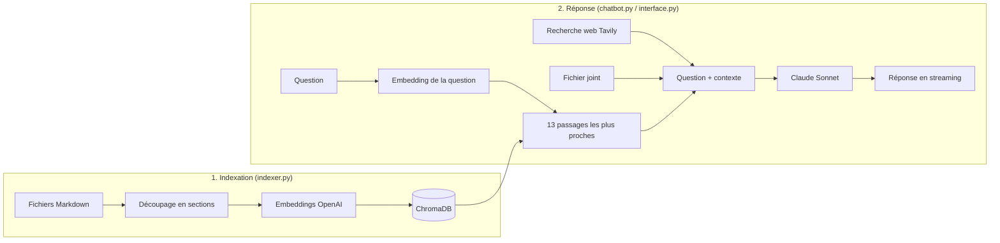

# NEVEN : assistant IA avec RAG

NEVEN est un assistant que j'ai codé en Python. Il répond à des questions en s'appuyant sur mes propres documents, grâce à la technique du **RAG** (Retrieval-Augmented Generation). Il peut aussi chercher sur le web et lire un fichier envoyé par l'utilisateur.

Projet personnel réalisé en 2026, pendant ma première année de BUT Informatique à l'IUT de Lannion, pour apprendre Python et le fonctionnement des agents IA.

## Ce que fait l'assistant

- Il répond en français à partir d'une base de documents Markdown.
- Il garde l'historique de la conversation.
- Il ajoute à sa réponse les résultats d'une recherche web (interface graphique).
- Il lit un fichier PDF ou texte joint à la question (interface graphique).
- Il indexe automatiquement les nouveaux documents ajoutés dans le dossier `documents/`.

## Comment ça marche



**1. Indexation.** `indexer.py` lit tous les fichiers `.md` du dossier `documents/`. Il découpe chaque fichier en morceaux (un morceau par section `##`). Pour chaque morceau, il demande à l'API OpenAI son **embedding** avec le modèle `text-embedding-3-small`, puis il range le texte, son embedding et le nom du fichier source dans une base **ChromaDB** enregistrée sur le disque.

**2. Recherche.** Quand on pose une question, le programme calcule l'embedding de la question et demande à ChromaDB les 13 morceaux dont le sens est le plus proche.

**3. Réponse.** Ces morceaux sont ajoutés à la question comme contexte, puis envoyés à **Claude** (API Anthropic, modèle Sonnet). La réponse s'affiche au fur et à mesure (streaming), et l'échange est gardé dans l'historique.

### Les embeddings en une phrase

Un embedding est une liste de nombres (ici 1 536) qui représente le sens d'un texte. Deux textes qui parlent de la même chose ont des listes proches. C'est ce qui permet de retrouver le bon passage même si la question n'utilise pas les mêmes mots que le document.

### Pourquoi le RAG

Un modèle comme Claude ne connaît pas mes documents. Plutôt que de l'entraîner, on lui donne à chaque question les passages utiles. Il répond donc à partir de sources précises, et la base se met à jour simplement en ajoutant un fichier.

## Technologies

| Rôle | Outil |
| --- | --- |
| Langage | Python 3.13 |
| Embeddings | API OpenAI (`text-embedding-3-small`) |
| Base vectorielle | ChromaDB (stockage local) |
| Modèle de réponse | API Anthropic (Claude Sonnet) |
| Recherche web | Tavily |
| Lecture de PDF | pypdf |
| Interface graphique | Gradio |
| Clés API | python-dotenv |

## Structure du projet

```
agent-rag/
├── Script_python/
│   ├── indexer.py               ← indexation des documents dans ChromaDB
│   ├── chatbot.py               ← assistant dans le terminal
│   ├── interface.py             ← assistant avec interface web (Gradio)
│   ├── NEVEN.bat                ← lancement en un clic sous Windows
│   └── api_rag.env.example      ← modèle du fichier de clés API
├── documents/                   ← base de connaissance (Markdown)
├── db/                          ← base ChromaDB (créée au premier lancement)
└── requirements.txt
```

## Installation et lancement

1. Installer les dépendances :
   ```
   pip install -r requirements.txt
   ```
2. Copier `Script_python/api_rag.env.example` en `Script_python/api_rag.env` et y mettre les clés OpenAI, Anthropic et Tavily.
3. Lancer l'assistant :
   - dans le terminal : `python Script_python/chatbot.py` (taper `exit` pour quitter) ;
   - avec l'interface : `python Script_python/interface.py`, puis ouvrir http://127.0.0.1:7860.

Au premier lancement de `chatbot.py`, les documents non encore indexés le sont automatiquement. Pour l'interface, lancer d'abord `python Script_python/indexer.py`.

`NEVEN.bat` contient le chemin de mon ancien PC : il faut l'adapter avant de l'utiliser.

## Pistes d'amélioration

- Utiliser l'historique fourni par Gradio dans `interface.py` au lieu d'une liste globale.
- Afficher la réponse en streaming dans l'interface (aujourd'hui elle s'affiche dans le terminal, puis d'un bloc dans l'interface).
- Ne recalculer que les embeddings des fichiers modifiés, et utiliser des identifiants liés au fichier source.
- Afficher les sources utilisées sous chaque réponse.

## Avant de rendre le dépôt public

- Vérifier qu'aucun fichier `api_rag.env` n'a été ajouté.
